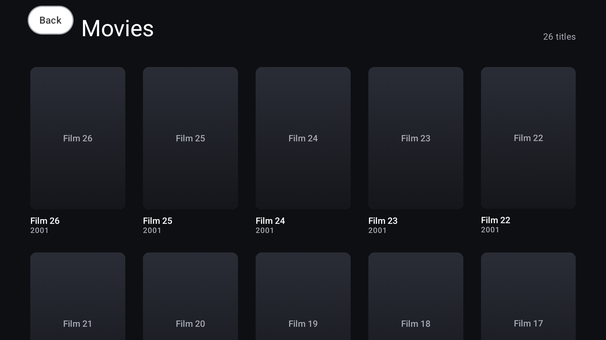
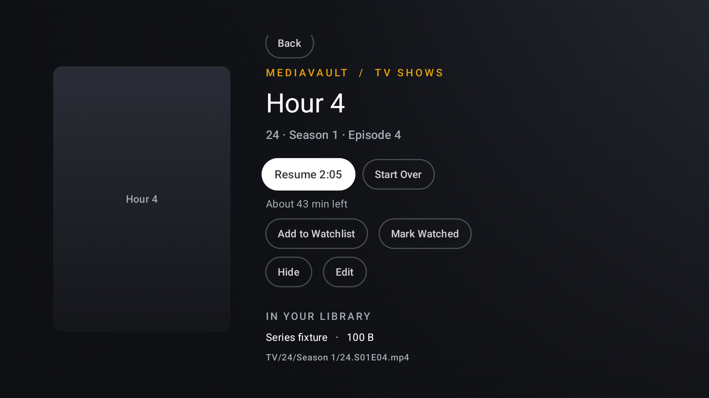
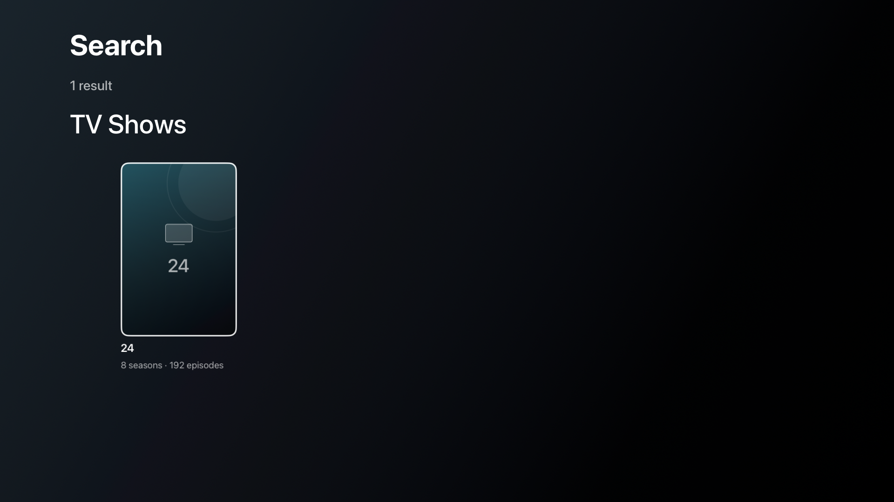
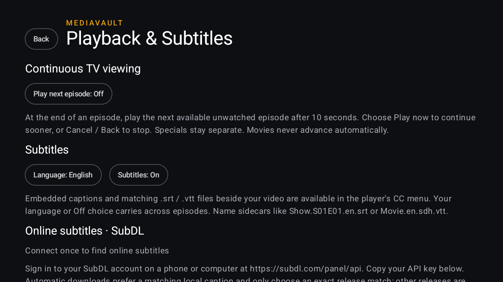
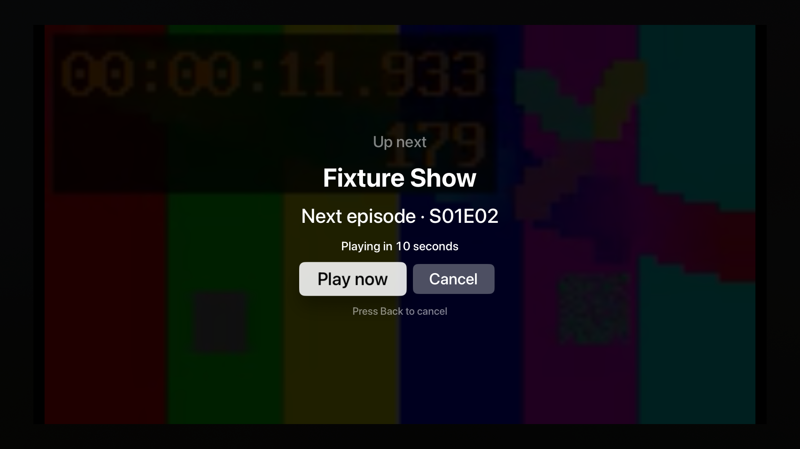
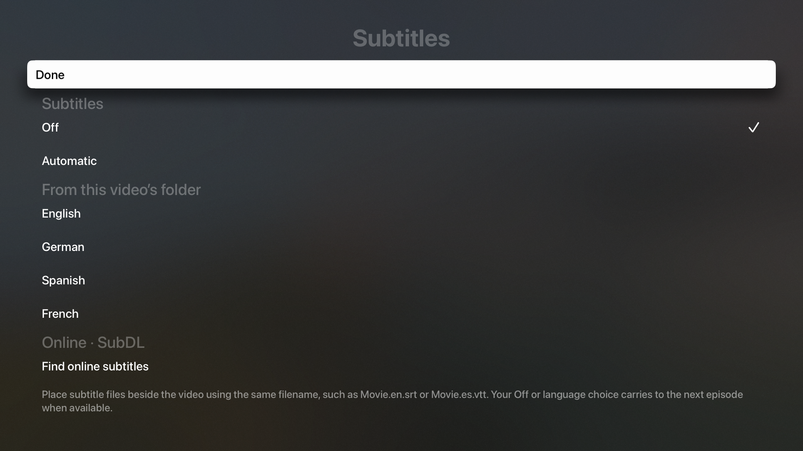
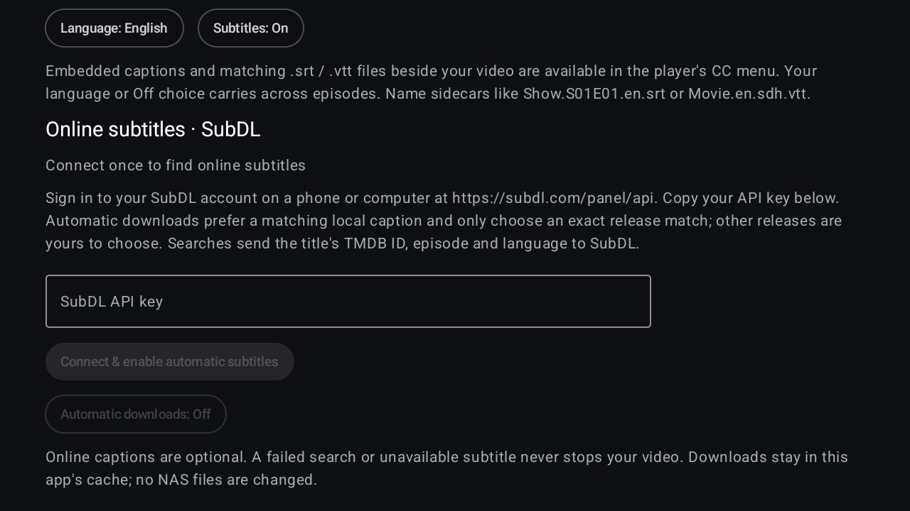
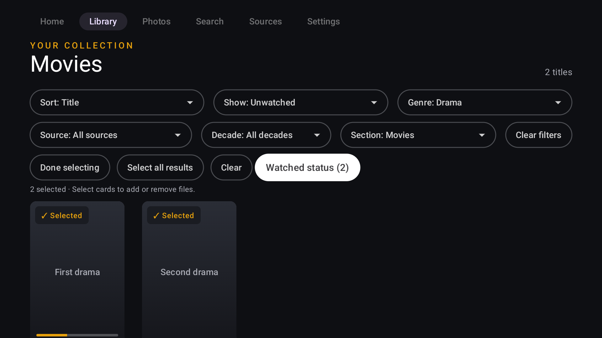
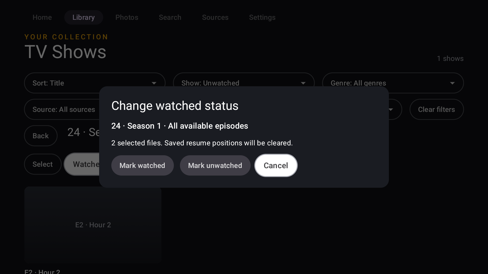
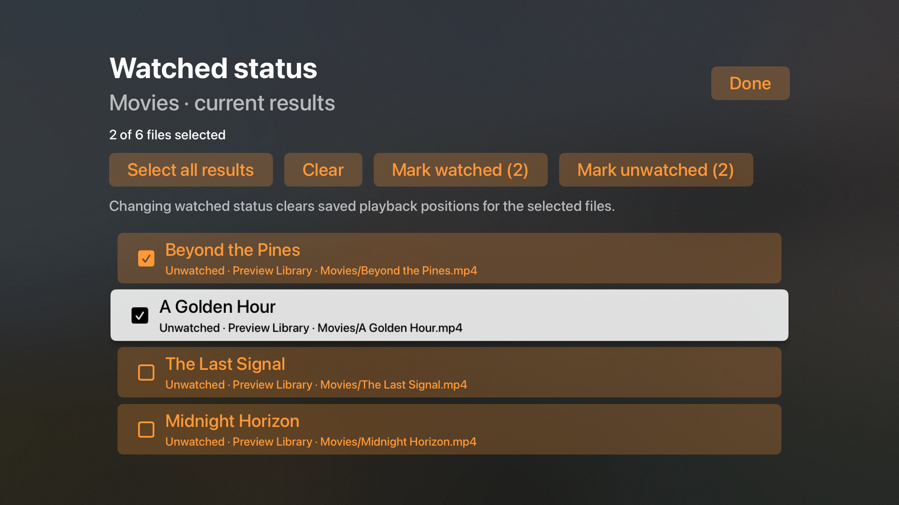

# MediaVault user guide

MediaVault organizes media stored on your NAS and opens it directly over your
network. Your files stay on the NAS; no media server or transcoding box is needed.

## Find your way around

**Library** remembers the last section you chose, including Movies,
Documentaries, TV Shows, or Music, when you return or reopen the app.
Use **Section** to switch categories. **Clear filters** resets the filters
within that section. Photos have their own tab.

Open **Settings** to check your installed version and build (under **About** on Apple TV).
The subtitles and continuous viewing update is version **1.3.0**, build **5**.

### Browse a complete Home collection

Choose **See all** beside a Home shelf to open its full collection. Movies,
Documentaries, TV Shows, Music, Watchlist, Unwatched, and Continue Watching are
no longer limited to the first 20 cards when you open the full view. Shows stay
grouped into seasons and episodes. **Back** returns to the same Home shelf.

Home collections use their own scope, so opening one does not change your saved
Library section, sort, or filters. If Library filters produce no results, choose
**Clear filters** in the empty screen. An empty section offers **Open Sources**;
an empty Watchlist explains how to save a title.

When resuming a title with a known duration, its detail screen shows approximately
how much time is left. MediaVault uses the duration recorded by playback first,
then metadata when needed. Unknown durations do not show an estimate.

Android TV examples from a separate sample library:





## Connect one shared parent folder

On first launch, choose **Find my NAS** on Home. To connect another folder, open
**Sources** and choose **Add NAS** (**Add NAS Source** on Android). Select a
discovered NAS or enter its address. MediaVault tries guest access first. If your NAS requires an account,
choose **Sign in** and enter its username and password in the app. A read-only NAS
account is recommended; keep its password out of chat, screenshots, and issue reports.

Choose the shared folder, then open the parent folder containing your media.
Choose **Use this folder & scan** to save it and start scanning. **Back** returns
through the folders you opened. If a folder cannot be opened, retry or go back
without re-entering the connection.

If discovery does not list your NAS, its hostname or IP address can still work.
Addresses such as `smb://media-nas` and Windows network paths such as
`\\media-nas\Media` are accepted for the server address; select the share and
media folder in the following steps. Connection options include a custom SMB port
when your NAS needs one. If it restricts share browsing, enter the share name manually.

If the share itself is named `Media`, select it and use its top-level folder.
If `Media` is inside another share, select that share and choose its `Media`
folder. MediaVault scans the selected folder and all its subfolders recursively.
You do not need to add each movie, show, or category separately.

A source pointing to `Media/Movies` finds only that folder and its descendants.
It cannot find sibling `Music`, `TV Shows`, or `Photos` folders. Edit the source to use the
common `Media` parent, then scan again.

## Choose what to scan or ignore

Open **Sources → Edit** for the NAS. Use **Choose scan folder** on Android or
**Choose a media folder** on Apple TV to browse the share, open subfolders, and
select **Use this folder** or the share root.

Under **Ignored folders and files**, open the folder/file picker. Choose
**Ignore folder** to exclude that folder and all its descendants, or **Ignore
file** to exclude only that file. You can also enter a relative path manually.
For example, if the selected scan folder is `Media`, use `Projects` or
`Movies/Extras/trailer.mp4`, without the NAS address or `Media` prefix.

Choose **Save & Scan** to apply the rules. Already indexed excluded items
disappear from this source's library immediately; the NAS files and their saved
playback history are kept. To restore an item, choose **Include again** (or
**Stop ignoring** on Apple TV), save, and let the scan finish. Rules apply only
to that NAS source. If another source scans the same files, set its rules too.

Changing the NAS address, port, share, or scan folder clears its relative
exclusions so they do not apply to unrelated folders. Select the exclusions
again for the new location.

Software dependency folders such as `node_modules` and TypeScript declaration
files (`.d.ts`) are skipped automatically. Other `.ts` files are checked for
MPEG transport-stream content before being added, because `.ts` can also mean
TypeScript source code. Rescan an existing source to clear previously imported
code files from the library.

## Use clear names

For example:

```text
Media/
  Movies/Arrival (2016)/Arrival (2016).mkv
  Documentaries/Documentary Title (2020)/Documentary Title (2020).mp4
  TV Shows/Show Name (2020)/Season 01/ShowName.S01E01.mkv
  Music/Artist/Album/01-Song.mp3
  Photos/Family Trip/Beach.jpg
```

Include a title and release year for movies and documentaries. For television,
include a season/episode marker such as `S01E01`. Keep each show's seasons under
one show folder. Browse a show's master poster, choose a season, then select an
episode tile to play it.

Names such as `[1x02]`, `S01 E02`, and `S01xE02` also work, including folders
named `Show Name Season 1`. Under `TV Shows`, the show folder supplies the shared
title even when episode filenames use a different title for each season. Local
grouping does not require an artwork key or another scan after an app update.
Unnumbered extras need a season/episode marker, such as `S00E01`, to appear in
the show's **Specials** season.

A numbered season folder can supply the season when the filename supplies the
episode, as in `TV Shows/24/Season 02/E03.mkv`. Without matched genres,
`Documentary Films`, `Music Videos`, and `Concerts` also work as category folders.
A concert video can fetch a poster and description like other films.

For audio music, consistent artist and album folders help identify the files.
TMDB is not an audio album catalog: its Music category describes screen content
such as music films, not MP3 artist, album, or cover-art information.

## Browse photo albums

Keep related photos in a folder, such as `Media/Photos/Family Trip`. Include that
folder or its parent in your NAS source and scan again. Open **Photos**, choose
an album, and select a thumbnail to view the photo full screen. **Previous** and
**Next** move through the album; **Back** returns to its thumbnails.

Albums follow the NAS source and the folder containing each photo. Both apps
recognize JPEG (`.jpg`, `.jpeg`), PNG, WebP, HEIC, and HEIF files. Viewing depends
on the device's image decoder; a damaged file or unsupported encoding may not
open. Keep the NAS reachable while browsing, and use **Try again** if a photo
could not be loaded. Files larger than 64 MB cannot be opened; large images are
reduced for display without changing the original. Photos are read directly
from the NAS and are not sent to TMDB.

## Add metadata and artwork

For personal use, obtain a free TMDB API key or read access token from
themoviedb.org under **Settings → API**. Enter it in MediaVault's **Settings** and
choose **Save Key & Fetch Missing Metadata**. Do not paste the key into chat.
Matching sends the parsed title and year to TMDB; your media files stay on the NAS.
See [TMDB's API FAQ](https://developer.themoviedb.org/docs/faq) for personal-use terms.

Matching provides real titles, descriptions, posters, and categories. A matched
movie's metadata takes priority over folder-name guesses when classifying movies,
documentaries, and music-related films.

Automatic matching checks the title before using the release year to rank
candidates. For short titles such as *Up*, the normalized display title or
original title must match exactly.
If a previously matched film has the wrong poster or genres, open its detail
screen, choose **Edit**, and use **Fix Match** to select the correct film.

Without a key, new unmatched items use filename/folder information and placeholder
artwork. A folder label alone cannot identify the correct movie. If an item is
unknown or incorrectly matched, check its title and year and use the manual match
correction. Different films or series can share the same name.

## Browse with filters

Open a library section and choose **Genre**, **Source**, or **Decade** to see
the available choices. Check as many as you want, then choose **Apply**.
**Back** cancels the changes in the open list.

For example, choosing *Comedy* and *Drama* includes titles in either genre.
Adding the *1990s* narrows those titles to that decade. Choose **Clear filters**
to see the whole section again. **Sort** changes the order of the results.

## Find a show or an episode

Search a series name to see one show card, then choose its season and episode.
The show opens with all its available seasons, even when only some episodes
match your search. Matched series names and local folder names both work.

Use an episode title or a code such as `S02E03` to find a specific episode.
Broad searches group many matching episodes under a show card with a match
count. **Back** keeps your search text and restores your place in the results.
Photos appear as photos and open their album viewer.



## Continue a series from Home

**Continue Watching** shows one card per series you have started. **Resume**
opens the episode you paused and keeps its saved position. When you finish an
episode, the card can offer the next unwatched episode in your library.

Check the season and episode number on the card. For example, if you finish
`S01E01` and `S01E03` is the next playable episode on your NAS, **Next available**
lets you decide whether to skip ahead. Select the card to see the details,
then choose **Play** or **Resume**. You can also open the next episode from
the current episode’s details. Specials are followed separately.

## Play the next episode automatically

On Apple TV, open **Settings** and enable **Play next TV episode automatically**.
On Android TV, open **Settings → Playback & Subtitles** and turn **Play next episode** on.
This option starts off on both platforms.
When an episode finishes normally, MediaVault shows the next available unwatched
episode and a ten-second countdown. Choose **Play now** to continue immediately,
or **Cancel** (or press **Back**) to stop automatic advance.

Check the season and episode label: **Next available** can mean an episode is
missing from your library or already watched. Specials stay separate from regular
seasons. Movies, playback errors, leaving the player, and commercial trial cutoffs
do not start another episode. Switching away from the app cancels a pending
countdown. The next file is checked again before playback begins.



Apple TV countdown from a separate sample library:



## Use subtitles

Open **Subtitles** in the player to choose an embedded track, a subtitle stored
beside the video, or **Off**. MediaVault remembers your subtitle choice where a
matching language is available in the next episode.
On Apple TV, press **Up** to reveal the playback controls first.



For local subtitles, place an extracted `.srt` or `.vtt` file in the video's
folder. Match the full video filename before its extension, optionally adding a
language code:

```text
Movies/Arrival (2016)/Arrival (2016).mp4
Movies/Arrival (2016)/Arrival (2016).en.srt
Movies/Arrival (2016)/Arrival (2016).es.vtt
TV Shows/Example/Season 01/Example.S01E01.mp4
TV Shows/Example/Season 01/Example.S01E01.en.srt
```

This also works with subtitles downloaded from YIFY: extract the subtitle from
its archive and rename it to match the video. MediaVault does not currently search
or download directly from YIFY. Local subtitles need no online account or new
library scan. Ignored files stay ignored; subtitle files are not added as movies.
Files must be readable SRT or WebVTT and no larger than 2 MB.

### Connect SubDL once

1. On a phone or computer, sign in to [SubDL's API panel](https://subdl.com/panel/api)
   and create a free API key.
2. In MediaVault, open **Settings → Playback & Subtitles** on Android TV, or
   **Settings → Subtitle language & SubDL setup** on Apple TV, and enter the key.
   Keep it out of chat and screenshots. Apple TV displays a QR code for the setup page.
3. Choose your preferred language, then **Connect & enable automatic subtitles**.
   Wait for the connection confirmation. An invalid key or unavailable service shows
   an error so you can correct it and retry.



MediaVault prefers matching local or embedded subtitles. When automatic online
subtitles are enabled, it searches SubDL for the matched title and language. An
automatic choice requires a matching release filename; otherwise use the player's
online search to choose a release yourself. **Off** prevents automatic selection.
You can disconnect SubDL in Settings and continue using local subtitles.

If connection fails while the service works on another device, check that your
TV or emulator has the correct date and time. A stale clock can prevent secure connections.

Online lookup uses the title's TMDB match and, for TV, its season and episode.
If a title is unmatched or wrongly identified, use **Fix Match** first. Different
cuts can have different subtitle timing even when they share a title; choose a
release matching your file. Only SRT/WebVTT downloads are supported in this update.
Provider request limits and subtitle availability apply.

SubDL receives the title identifier, media type, episode and language; your video,
NAS password, and NAS folder path stay on your device/network. Downloads are kept
in app memory or its local cache and do not change files on the NAS. SubDL uses a
one-time API-key connection; MediaVault does not collect your SubDL password.
See [SubDL's API documentation](https://subdl.com/developers).

## Change watched status in bulk

In **Library**, choose **Select** and select the videos you want to change.
**Select all results** uses your current filters. On Android TV, open
**Watched status** after selecting the cards. Check the selected count,
then choose **Mark watched** or **Mark unwatched**. **Clear** removes the
selection, and **Back** cancels it.

To update a show, open its season list and choose **Watched status**. Open a
season first to update that season's episodes. These shortcuts cover the whole
available show or season, including watched episodes and episodes outside your
Watchlist. Hidden, missing and excluded files are left out. Review the named
scope and count before applying a change.

Both actions clear saved resume positions for the selected files. Marking a
video unwatched lets you start it again from the beginning. Alternate copies
are separate files and are included in the count when selected.







## Use household profiles

Household profiles are optional and live on this TV. Enabling them preserves your
library, source credentials and existing playback history. There is no email
registration or online MediaVault account.

1. Open the household-profile setup in **Settings** and enter a six-digit Admin
   PIN twice. Keep the PIN somewhere you can recover it yourself.
2. Enter **Admin**, add a named viewer and choose the NAS folders they may see.
   A new viewer starts with no access. Allowing a folder includes its subfolders;
   allowing a source includes media within that source's configured scan root.
   A newly added source needs its own permission.
3. Choose the highest allowed **US movie rating** and **US TV series rating** separately,
   or choose no rating limit. Set an optional six-digit PIN for that viewer.
4. Switch profiles to browse as that person. Admin and any protected viewer
   require their PIN. Returning after the app goes into the background locks the
   household session; choose a profile again.

Only Admin manages shared sources, metadata and household permissions. Restricted
titles, artwork and photos stay hidden in browsing, search and playback choices.
An empty viewer library can mean no folders are allowed or the rating rules exclude
the available videos; return to Admin to review those settings.

Age limits use actual **US movie/TV certifications**, not the numerical audience
score shown with movie details. With a limit active, unknown, unmatched and unrated
videos stay hidden. Connect TMDB and fetch missing metadata to fill available
certifications. Correct a wrong title match as Admin before relying on its rating.
TV limits use the show's TMDB US rating, which can differ from a particular
episode's broadcast rating. TV-G permits all-ages content; TV-Y7 also permits
content directed to children seven and older, including TV-Y7-FV. The editor lists
the ratings each choice includes. [US TV rating definitions](https://www.tvguidelines.org/resources/TheRatings.pdf)
Photos and audio have no movie/TV age rating and use folder permissions instead.

Each viewer starts with a separate Watchlist, watched status and resume history.
Admin retains the history from before profiles were enabled. Bulk watched actions
affect the current person's accessible titles. Switching profiles stops current
playback and the next-episode countdown. Commercial trial usage and purchases remain
shared across the installation.

This is access control inside MediaVault. It does not alter files or NAS permissions,
create cloud accounts, sync profiles to another TV, or prevent the device owner
from changing or clearing app data. There is no unauthenticated in-app PIN reset.

## Check the scan and playback

Keep the NAS reachable while scanning. Progress and partial results can appear
before completion; they do not mean every folder has finished. Check the status
and the last successful scan time. If a scan fails, correct the connection or
credentials and retry.

MediaVault does not transcode. A filename extension identifies a candidate
format; the file must contain real media, and the device must support the
audio/video codecs inside it. Unsupported formats show an explanation instead
of Play controls. Apple TV also checks the actual asset before starting playback.

| Platform | Video candidates | Audio candidates |
| --- | --- | --- |
| Android TV | MP4, M4V, MOV, MKV, WebM, AVI, MPEG-TS, MPEG-PS, FLV | MP3, M4A, AAC, FLAC, WAV, Ogg, Opus |
| Apple TV | MP4, M4V, MOV | MP3, M4A, AAC, FLAC, WAV, AIFF/AIF |

This table describes the current app's file playback, not every format supported
by other players. Android's AVI support depends on its extractor and device
codecs; FLV seeking is limited. WMV, ISO, and M2TS are cataloged but cannot be
played by these built-in players. WMA cannot play on either platform, and AIFF/AIF
cannot play in this Android build. Unsupported real media can remain in the
library for organization.

The `.ts` suffix is shared by MPEG transport-stream video and TypeScript source
code. `.d.ts` is a TypeScript declaration file and is never media. Scanning checks
the packet structure of ambiguous `.ts` files; Android repeats that check before
playing an existing entry. Android's TS player requires standard 188-byte packets;
192-byte M2TS and 204-byte variants are not enabled for playback. The player then
checks whether it can decode its tracks.
Standalone TS files are not enabled for playback in the current Apple TV app.

Format references: [Android Media3 progressive formats](https://developer.android.com/media/media3/exoplayer/progressive),
[Media3 codec support](https://developer.android.com/media/media3/exoplayer/supported-formats),
[the app's Media3 1.8.0 extractors](https://github.com/androidx/media/blob/1.8.0/libraries/extractor/src/main/java/androidx/media3/extractor/DefaultExtractorsFactory.java),
[its TS packet parser](https://github.com/androidx/media/blob/1.8.0/libraries/extractor/src/main/java/androidx/media3/extractor/ts/TsExtractor.java),
[Apple asset playability](https://developer.apple.com/documentation/avfoundation/avasset/isplayable),
and [TypeScript declaration files](https://www.typescriptlang.org/docs/handbook/2/type-declarations.html).
